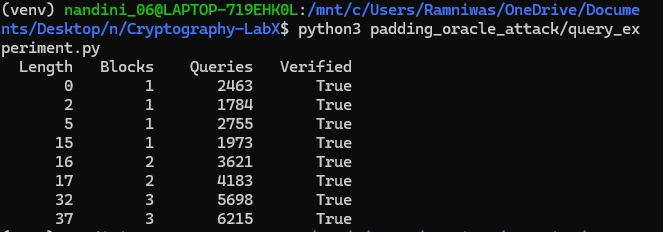

# Padding Oracle Attack: Query Count Analysis

## Aim

To study how plaintext length affects the number of oracle queries required by the AES-CBC Padding Oracle Attack.

## Method

The existing padding oracle implementation was tested with plaintexts of different lengths. For each plaintext, the number of oracle queries was counted, and the recovered plaintext was compared with the original.

## Results

| Plaintext Length (bytes) | Ciphertext Blocks | Oracle Queries | Verified |
|---:|---:|---:|:---:|
| 0 | 1 | 1786 | Yes |
| 2 | 1 | 2106 | Yes |
| 5 | 1 | 1686 | Yes |
| 15 | 1 | 2015 | Yes |
| 16 | 2 | 3993 | Yes |
| 17 | 2 | 4827 | Yes |
| 32 | 3 | 5244 | Yes |
| 37 | 3 | 6984 | Yes |

## Observations

The experiment successfully recovered all eight plaintexts. The number of oracle queries varied with the plaintext length and the guesses required to recover each byte.

AES uses a block size of 16 bytes. PKCS#7 padding adds a full block when the plaintext length is an exact multiple of 16 bytes. Therefore, a 16-byte plaintext requires two ciphertext blocks, while a 17-byte plaintext also requires two blocks.

The query count does not increase uniformly with plaintext length because the number of guesses required for each byte varies.

## Conclusion

The experiment demonstrates that a Padding Oracle Attack can recover plaintext through repeated oracle queries when the oracle reveals whether the padding is valid. The results illustrate the relationship between ciphertext block count, byte-recovery attempts, and total oracle queries.

## Experimental Evidence

The following screenshot shows the output of the query-count experiment for plaintexts of different lengths.

